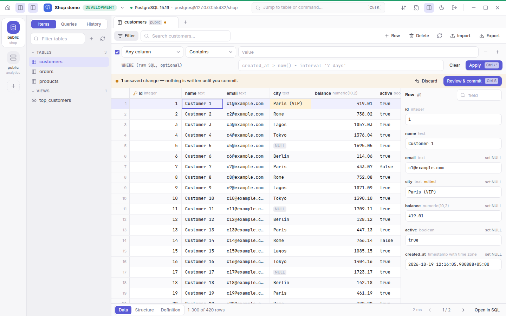
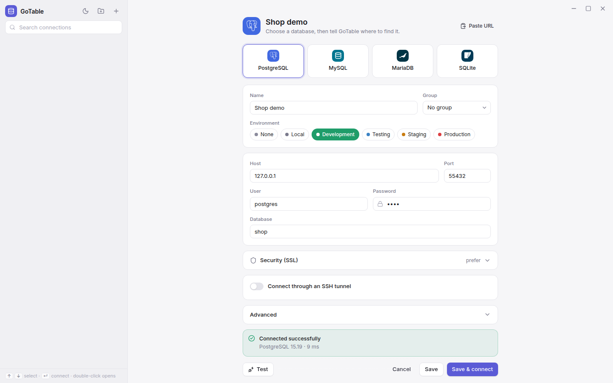
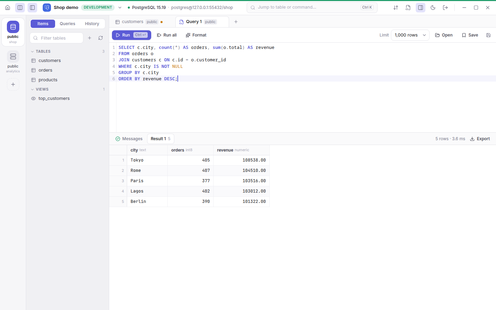
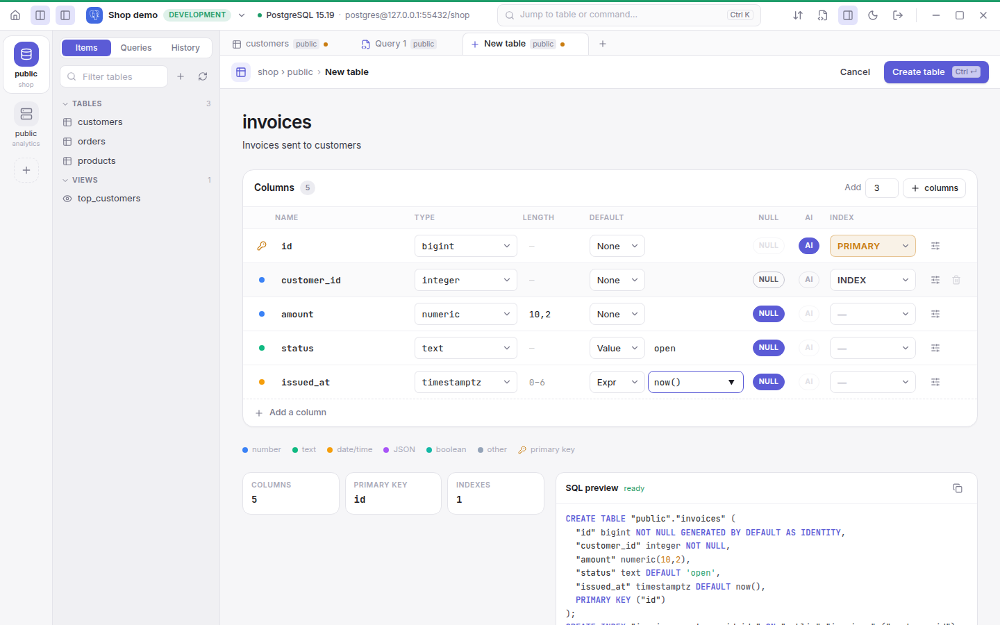
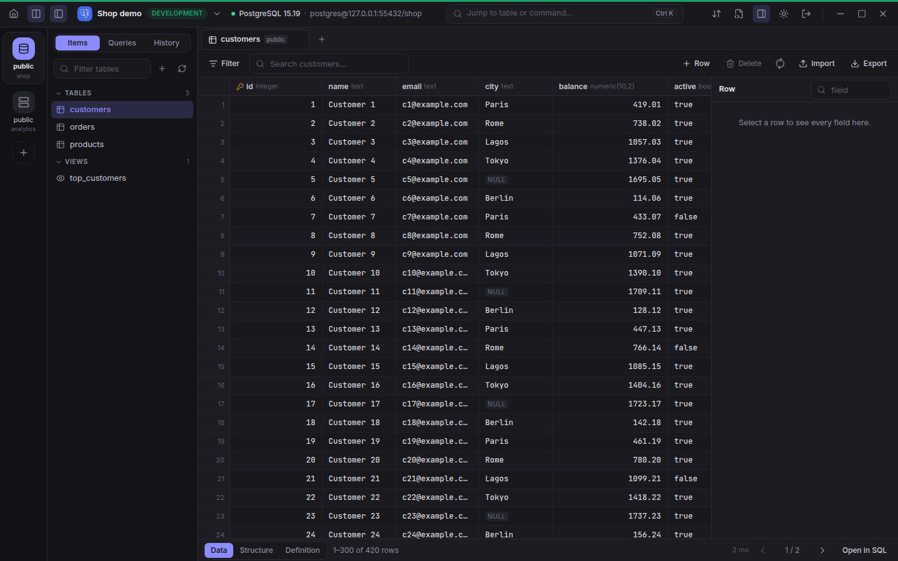

# GoTable

A modern database client for PostgreSQL, MySQL, MariaDB and SQLite: a Go
backend with a web UI, shipped as one binary that opens in a native window
([Wails](https://wails.io): WebKitGTK on Linux, WebView2 on Windows, WebKit
on macOS).



| Connections | Query editor | New table | Dark mode |
|---|---|---|---|
|  |  |  |  |

The workflow follows TablePlus's layout: connection list beside the
connection form, a table sidebar, tabs, a filter row above the grid, a row
inspector and a Data / Structure / Definition switch. Everything was written
from scratch; no TablePlus code or assets are used.

## Features

- **Connections**: list with search, groups, environment colours (production
  windows get a red bar and a warning before commit), driver tiles, inline
  *Test*, paste a `postgres://…` URL, SSL modes and certificates, SSH tunnels
  (password, key, encrypted key). Passwords live in the system keyring and
  are never sent to the UI.
- **Data grid**: virtualised, keyboard driven (arrows, Enter/F2 to edit,
  typing replaces, Delete marks rows, Ctrl+C copies), resizable columns,
  click-to-sort, NULL shown as a pill, edited / new / deleted cells colour
  coded, right-aligned numbers, row inspector, context menu (copy value / JSON
  / INSERT, filter by value, set NULL, duplicate, delete).
- **Filtering**: quick search across all columns, a filter row per condition
  (17 operators) and an optional raw `WHERE`.
- **Safe editing**: changes stay pending until *Review & commit* (Ctrl+S)
  shows the exact SQL; it runs in one transaction and rolls back on error.
  Rows changed by someone else are detected.
- **SQL editor**: CodeMirror with highlighting, table/column autocomplete,
  Ctrl+Enter runs the statement under the cursor or the selection,
  Ctrl+Shift+Enter runs all, Format / Ctrl+I beautifies the selection or the
  whole query in the connection's dialect (one undo reverts it), Stop cancels
  on the server, row limit, multiple
  result tabs, messages with plain-language errors, open/save `.sql`; query
  tabs are restored on the next start.
- **Sidebar**: Ctrl+A selects all listed tables (respecting the filter),
  Ctrl/⌘+click and Shift+click select several; the selection can be exported
  or deleted together. Delete shows the exact DROP SQL, runs in one
  transaction where the database allows it, orders related tables so foreign
  keys don't get in the way, can CASCADE to dependent objects, and asks for
  DELETE to be typed for several tables or on production.
- **Structure**: columns and indexes, *Add column* with type suggestions per
  database, default (value, expression or NULL), NULL toggle, comment, MySQL
  position, and a live preview of the exact `ALTER TABLE` before it runs.
- **Import & export** with live progress (percent, MB or rows, speed, time
  left; cancel anytime; jobs keep running in the background and are listed in
  the status bar):
  - *Database*: export selected tables and views as a portable SQL dump
    (structure and/or data, optional DROP, foreign keys added after the data,
    sequences/auto-increment restored, binary data kept) or as a ZIP of CSVs;
    import any SQL script or dump — `pg_dump` plain format including
    `COPY … FROM stdin`, `mysqldump` (with `/*!…*/` and `DELIMITER`), SQLite
    `.dump` — either all-or-nothing in one transaction or skipping failed
    statements (reported with line numbers).
  - *Table*: export CSV / JSON / SQL (all filtered rows or a page); import CSV
    with delimiter detection, a preview, column mapping by name, NULL rules and
    an optional "delete existing rows first", in one transaction.
  - *Query results*: CSV / JSON / INSERT export in the browser.
  - **Large files**: everything streams — files are never held in memory.
    Measured on this machine: a 1 GB SQL file (5.4 M rows) imports into SQLite
    in 26 s and PostgreSQL in 86 s, a 914 MB `pg_dump` in 28 s, and a 1 GB
    dump exports in 24 s, all with under 30 MB of memory. Very large files
    can be imported by path to skip the upload copy.
- **Several databases at once**: **Ctrl+D** (or *Open database* in the
  sidebar) opens another database next to the current one — schemas of the
  same database, MySQL databases, attached SQLite files, or another
  PostgreSQL database on the server (opened on its own connection). Open
  databases sit in a narrow rail on the far left (click or **Alt+1…9** to
  switch, × to close); the table sidebar shows only the active database,
  which also decides what **Ctrl+P** (tables of the current database),
  new queries and import/export act on. Tabs show their database, query tabs
  always run in the database they were opened in, and the open databases
  are remembered per connection. **Ctrl+K** searches everything.
- **Everywhere**: command palette (Ctrl+K), toasts, light/dark (Ctrl+Shift+L),
  several connections open at once.
- **Feels like a desktop app**: a native window; exports and saved results
  use the system *Save As* dialog and Go writes the file directly; imports
  use the system *Open* dialog and read the file in place (no copy, any
  size); unsaved edits are guarded
  by in-app dialogs (*Review & commit… / Discard / Cancel*), never browser
  alerts; F5 / Ctrl+R refresh data instead of reloading; browser shortcuts,
  the browser context menu and file-drop navigation are disabled.
- **Saved queries and history.** The sidebar has three tabs: *Items* (tables),
  *Queries* and *History*. **Ctrl+S** in a query tab saves it under a name
  (later Ctrl+S updates it; a dot on the tab means unsaved edits). History
  records every query you run and every change you commit from the grid,
  with time, duration, rows and errors; click an entry to open it again, or
  right-click → *Run again*. Both are stored next to `connections.json`
  (`queries.json`, `history.jsonl`, last 1,000 entries per connection).
- **Foreign keys** (single- and multi-column). Foreign key columns show a
  link icon in the header; hover or select a cell and click its arrow (or
  right-click → *Open …*) to open the referenced table filtered to that row.
  Double-click (or Enter) opens a searchable list of the referenced rows,
  showing the key plus a readable column such as `name`; picking one sets
  every column of the key. *Set NULL* and *Edit as text* are at the bottom,
  and typing into the cell still edits it as text.
- **One instance.** Starting GoTable while it's already running brings its
  window to the front instead of starting a second one.
- **Creating tables and databases.** *New table* (the **+** next to the
  sidebar's refresh, right-click a database in the rail, or Ctrl+K) opens a
  designer tab modelled on phpMyAdmin: per column a name, a type from the
  database's own grouped list (Numeric, Date and time, String, JSON,
  Spatial… plus PostgreSQL enums/domains/extension types), Length/Values,
  default, NULL, index (PRIMARY — several make a composite key — UNIQUE,
  INDEX, FULLTEXT on MySQL/MariaDB) and auto-increment; more options per
  column (collation from the server's list, UNSIGNED, ON UPDATE
  CURRENT_TIMESTAMP, PostgreSQL arrays, comment, reorder); table options
  (engine, character set and collation on MySQL/MariaDB, STRICT on SQLite);
  *Add N columns*. The exact SQL is shown live and problems are explained
  before anything runs; **Ctrl+Enter** creates the table. *Add column* uses
  the same type list. *Create database…* in the Ctrl+D list makes a
  database (PostgreSQL also a schema; MySQL/MariaDB with a character set)
  and opens it; on SQLite it creates a new database file, saves it as a
  connection and opens it.
- **Switching tabs.** **Ctrl+Tab** / **Ctrl+Shift+Tab** (or **Ctrl+PageDown**
  / **Ctrl+PageUp**) go to the next / previous open tab, wrapping around;
  **Ctrl+1…9** jump to a tab, **Ctrl+W** closes it.
- **Collapsible panels.** **Ctrl+B** hides/shows the table sidebar,
  **Ctrl+Shift+B** the database rail (also the two buttons top-left).

## Install

Download the file for your system from the project's **Releases** page:

| System | File | Install |
|---|---|---|
| Ubuntu 22.04+, Debian 12+ | `gotable_<version>_amd64.deb` | `sudo apt install ./gotable_*_amd64.deb` |
| Fedora 36+ | `gotable-<version>-1.x86_64.rpm` | `sudo dnf install ./gotable-*.x86_64.rpm` |
| Other Linux | `GoTable-<version>-x86_64.AppImage` | `chmod +x GoTable-*.AppImage`, then run it (needs WebKitGTK 4.1, see below) |
| Windows 10 / 11 | `gotable-<version>-windows-amd64.exe` (or the `.zip`) | run it |

The `.deb` and `.rpm` pull in WebKitGTK and add GoTable to the app menu.
`gotable -version` prints the installed version.

## Supported platforms

| Platform | Window | Status |
|---|---|---|
| **Linux**, Wayland session — GNOME, KDE Plasma, Sway, Hyprland… on Fedora, Ubuntu 22.04+, Debian 12+, Arch, … | native (WebKitGTK 4.1), GoTable's own title bar | tested on Fedora 44 / KDE Plasma; other distros and desktops use the same libraries and are expected to work |
| **Windows** 10 / 11 | native (WebView2, built into Windows), system title bar | builds and passes the checks; not yet tried on real Windows |
| **macOS**, or Linux on **X11** | open GoTable in a browser (`-no-window`) or the Chrome app window (`make build-browser`) | the native window isn't supported yet |

On Linux the native window needs a Wayland session (the default on current
GNOME and KDE). In an X11 session GoTable says so and exits; use
`gotable -no-window` there.

## Build and run

You need **Go 1.26+** and **Node 20.19+** (or 22.12+), plus, for the native
window, the WebView libraries of your system.

### Linux

```sh
# Build tools and WebKitGTK 4.1 headers
sudo dnf install gcc webkit2gtk4.1-devel                    # Fedora
sudo apt install build-essential libwebkit2gtk-4.1-dev      # Ubuntu 22.04+, Debian 12+
sudo pacman -S base-devel webkit2gtk-4.1                    # Arch

make build          # builds the web UI, then bin/gotable
bin/gotable         # opens GoTable
```

To run a built `gotable` on another machine, only the WebKitGTK runtime is
needed: `webkit2gtk4.1` (Fedora), `libwebkit2gtk-4.1-0` (Ubuntu/Debian),
`webkit2gtk-4.1` (Arch).

### Windows

WebView2 is part of Windows 10 and 11, so only Go and Node are needed. In
PowerShell:

```powershell
cd frontend; npm ci; npm run build; cd ..
go build -tags desktop,production -ldflags "-s -w -H windowsgui" -o bin\gotable.exe .\cmd\gotable
.\bin\gotable.exe
```

From Linux, `make build-windows` cross-compiles the same `bin/gotable.exe`.
On Windows GoTable keeps the system title bar; shortcuts, the native
Save/Open dialogs and saved passwords (Credential Manager) work as on Linux.

### Any system, in a browser

```sh
make build-browser            # no C compiler or WebKitGTK needed
bin/gotable                   # opens a Chrome / Chromium / Edge app window
bin/gotable -no-window        # prints a URL to open in any browser
```

`GOTABLE_BROWSER=chromium bin/gotable` picks the browser.

The server listens on 127.0.0.1 only and requires a random per-launch token
(exchanged for an HttpOnly cookie); it also checks Host and Origin headers.
Connections are saved in `~/.config/gotable/connections.json` (on Windows
`%AppData%\gotable\connections.json`).

For UI development: `bin/gotable -no-window -addr 127.0.0.1:7777`, then
`GOTABLE_TOKEN=<token> npm run dev` in `frontend/`.

## Tests

```sh
make test       # Go unit + SQLite + SSH + HTTP API tests, and UI unit tests
make test-dbs   # also PostgreSQL 15, MySQL 8.4 and MariaDB 11 in Docker
make e2e        # Playwright drives the real binary in headless Chrome
GOTABLE_E2E_PG=postgres://user:pw@host/db make e2e   # adds a Postgres scenario
```


## Continuous integration and releases

GitHub Actions (`.github/workflows/`):

- **CI** — on every push and pull request: TypeScript and unit tests, `go
  vet`, the Go tests against real PostgreSQL 15, MySQL 8.4 and MariaDB 11
  (service containers), and the end-to-end tests in Chrome, including the
  PostgreSQL scenario (`scripts/e2e-demo.sql`).
- **Build** — on every push to `main`: the `.deb`, `.rpm`, AppImage,
  `.tar.gz` and Windows `.zip`, downloadable from the run's artifacts.
  Linux builds run on Ubuntu 22.04, so one binary covers Ubuntu 22.04+,
  Debian 12+ and Fedora 36+.

To publish a release, push a version tag; the same files are attached to a
GitHub release with generated notes:

```sh
git tag v0.1.0
git push origin v0.1.0
```

The packaging is `scripts/package.sh` (`make package-linux` /
`make package-windows`), so it runs the same way locally.

## Layout

| Path | Responsibility |
|---|---|
| `internal/model` | connections, groups, JSON store, keyring, URL parsing |
| `internal/db` | dialects, SQL builders, streaming statement scanner, dump/import, engines, sessions |
| `internal/sshtunnel` | local port forwarding over SSH |
| `internal/export` | CSV / SQL / JSON writers |
| `internal/server` | local JSON API, auth, background jobs, uploads, plain-language errors |
| `internal/webui` | embeds the built UI |
| `frontend/` | React + TypeScript + Tailwind UI, Vitest and Playwright tests |
| `cmd/gotable` | starts the server and the window (`window_wails.go`; `window_browser.go` with `-tags browser`) |
| `packaging/` | app icon, desktop entry, `.deb`/`.rpm` definition (nfpm) |
| `scripts/` | release packaging, database test containers, end-to-end demo data |
| `.github/workflows/` | CI (tests) and Build (packages, releases) |

## Not implemented yet

Other engines (SQL Server, Redis, MongoDB, ClickHouse, …), renaming, changing
or dropping columns and indexes through the UI, ER diagrams, Excel import and
user management. PostgreSQL custom-format (`pg_dump -Fc`) archives need
`pg_restore`; plain SQL dumps are supported.

## License

[MIT](LICENSE).

## Trademarks

PostgreSQL, MariaDB and SQLite logos are trademarks of their respective
owners. They are shown only to identify the database engine a connection
uses; no endorsement is implied. The SVG artwork comes from
[Simple Icons](https://simpleicons.org) (CC0-1.0); see
`frontend/src/lib/driverLogos.ts` for the source and each owner's guidelines.
MySQL is a trademark of Oracle; GoTable shows a generic icon for it rather
than the MySQL logo.
